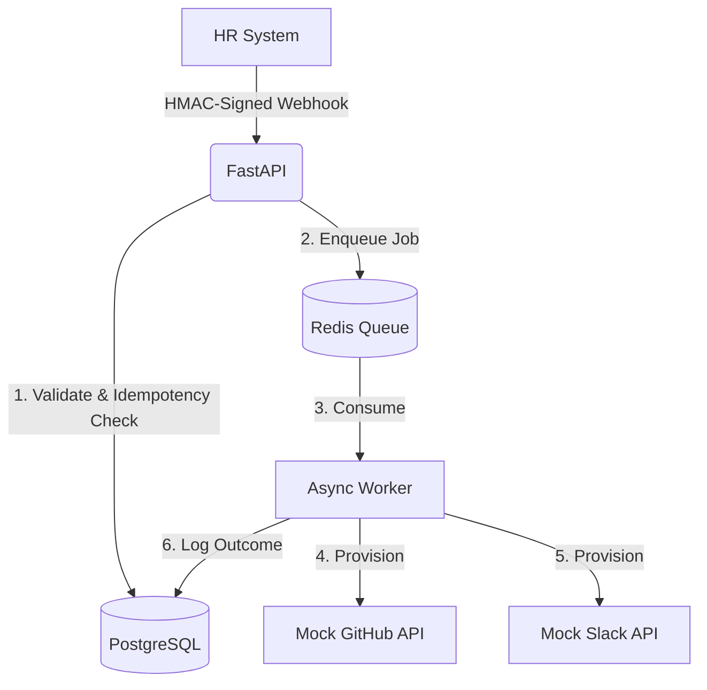

# Automated IAM Provisioning Service

An event-driven Identity and Access Management (IAM) orchestration API designed to automate user provisioning and deprovisioning across multiple external systems (e.g., GitHub, Slack) securely and reliably.

## 🏗️ Architecture



🚀 Features

Event-Driven Decoupling: API responds in <50ms by offloading slow external API calls to an async Redis queue (arq).
Resilient Retry Logic: Exponential backoff (2s, 4s) for transient failures (e.g., 429 Rate Limits), with a hard cap of 3 retries to prevent poison pills.
Cryptographic Security: HMAC-SHA256 signature validation on all incoming webhooks to prevent spoofing.
Immutable Audit Trail: Every state change (creation, success, failure, retry) is logged to a dedicated PostgreSQL table with JSON metadata for SOC2/ISO27001 compliance.
Role-Based Access Control (RBAC): JWT-based authentication protecting administrative endpoints (e.g., manual task retry, audit log retrieval).
Structured Logging: Machine-readable JSON logs via structlog for easy ingestion into SIEM tools (Datadog, Splunk).

🛠️ Tech Stack

Language: Python 3.12
Framework: FastAPI (Async)
Database: PostgreSQL 15 (with asyncpg and SQLAlchemy 2.0)
Message Queue: Redis 7 + arq
Security: python-jose (JWT), hmac (Webhook validation)
DevSecOps: GitHub Actions, gitleaks (secret scanning), Docker

🏃‍♂️ Quick Start

Note: For local development, this project is configured to connect to a local PostgreSQL instance (e.g., via pgAdmin 4) and a Dockerized Redis instance. To run the entire stack (including Postgres) in Docker, update the DATABASE_URL in docker-compose.yml from host.docker.internal to postgres.

Local Development (without Docker)
```
# 1. Start dependencies
docker-compose up -d postgres redis

# 2. Install dependencies
pip install -r requirements.txt

# 3. Run API and Worker in separate terminals
uvicorn app.main:app --reload --host 127.0.0.1 --port 8000
arq app.worker.WorkerSettings
```
Production-like Environment (Docker)
```
docker-compose up --build -d

docker-compose up --build -d
```
Access the interactive API docs at: http://localhost:8000/docs


🧪 Testing the Pipeline

Generate a signed webhook (using the provided sign.py script).
Send the webhook: Observe the API return 202 Accepted and the worker process the jobs.
Test Idempotency: Send the exact same payload twice; the second will return duplicate.

Test RBAC:

Get a viewer token: POST /auth/token with {"username":"viewer", "password":"viewer123"}
Try to access GET /api/v1/audit-logs → Returns 403 Forbidden.
Get an admin token and retry → Returns 200 OK with the audit trail.

text```
⚖️ Architectural Trade-offs & Future Improvements

User Status Aggregation: Currently, the User.status is updated by the last worker to finish. If GitHub succeeds but Slack fails terminally, the user is marked active.

Future Fix: Implement an aggregate status checker that queries all ProvisioningTask rows for a user and sets the user status to partially_provisioned or active based on a configurable threshold.
Queue Choice: arq was chosen for its native async compatibility with FastAPI and lightweight footprint.
Scale-up Path: For higher throughput or complex DAGs, migrating to Celery with Redis/RabbitMQ would be the next step.
Secret Management: Secrets are currently loaded from .env.
Production Path: Integrate with AWS Secrets Manager, HashiCorp Vault, or Kubernetes Secrets.
